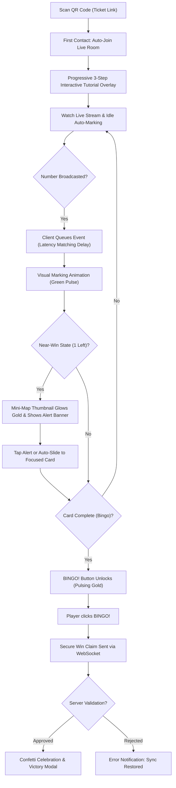
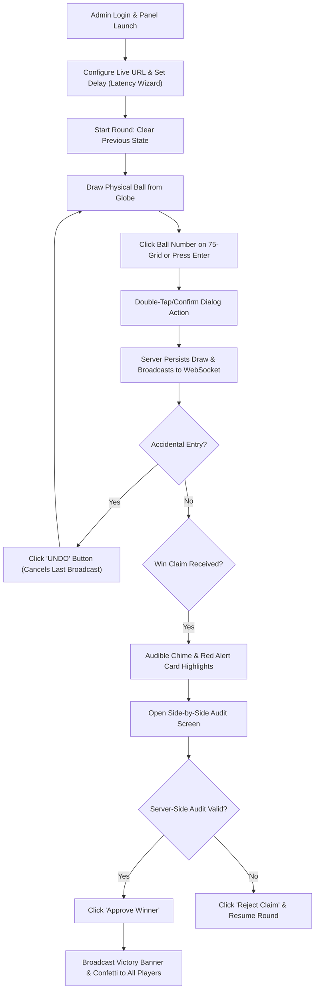

# UX Design Specification bingo-ai

**Author:** Jeyson
**Date:** 2026-05-16

---

## Executive Summary

### Project Vision
O **bingo-ai** é uma plataforma de bingo híbrida focada em acessibilidade e transparência. O objetivo é permitir que jogadores participem de sorteios físicos de forma remota, utilizando uma interface que sincroniza automaticamente a marcação das cartelas com a transmissão ao vivo, oferecendo a escolha entre a experiência 100% digital ou o uso da cartela física como suporte principal.

### Target Users
*   **Jogadores Remotos (Maria):** Pessoas de diversas faixas etárias, incluindo idosos e leigos digitais, que acompanham a live de casa. Buscam facilidade, clareza e uma forma de participar sem medo de "perder" um número sorteado.
*   **Administradores de Evento (Sr. José):** Organizadores que precisam de uma interface de controle robusta para espelhar o sorteio físico e gerenciar a sincronia do evento.
*   **Vendedores Locais (Roberto):** Facilitadores que vendem as cartelas físicas e explicam o funcionamento básico da plataforma.

### Key Design Challenges
*   **Onboarding para Leigos:** Como guiar um usuário que nunca usou a plataforma através do processo de ativação e jogo de forma rápida e acolhedora.
*   **Flexibilidade de Dispositivo:** Garantir que o "Cartelão" (4 cartelas) e o vídeo da live convivam harmoniosamente em telas de smartphones, tablets e computadores.
*   **Dualidade Digital-Físico:** Permitir que o usuário alterne entre a marcação automática visual e o modo "apenas acompanhamento" (para quem prefere riscar o papel), sem perder as notificações críticas de "Quase lá!" ou "Bingo!".

### Design Opportunities
*   **Guia Passo a Passo Interativo:** Um tutorial leve no primeiro acesso que ensina a escanear, acompanhar e "gritar" Bingo.
*   **Interface Adaptável (Responsive Layout):** Dashboards otimizados que aproveitam o espaço extra de tablets e PCs para mostrar estatísticas ou chat, mantendo o foco no celular.
*   **Modo de Visualização Oculta:** Uma funcionalidade de "Privacidade/Foco" que esconde a cartela digital para quem quer a experiência tátil da cartela de papel, mas mantém os alertas sonoros e visuais de vitória.

## Core User Experience

### Defining Experience
A experiência central do **bingo-ai** é a "Marcação Automática Assistida". O foco é eliminar o estresse de perder um número sorteado enquanto o usuário acompanha a live do YouTube. O sistema atua como um assistente inteligente que garante precisão total, permitindo que o jogador se concentre apenas na emoção do jogo.

### Platform Strategy
*   **Web Responsivo:** Suporte completo para Mobile (foco em toque), Tablet e Desktop (foco em mouse/teclado).
*   **Padrões de Interação:** Botões de alta visibilidade e áreas de toque amplas (mínimo 44x44px) para dispositivos móveis. Atalhos de teclado no painel administrativo para agilizar o registro das pedras.
*   **Conectividade:** Dependência de internet estável para WebSocket (tempo real); interface deve comunicar claramente estados de desconexão.

### Effortless Interactions
*   **Auto-Marking:** Números são marcados instantaneamente sem intervenção do usuário.
*   **Sincronia Automática:** A latência é ajustada centralmente pelo Admin, eliminando a necessidade de configuração individual.
*   **Tutorial de Primeiro Acesso:** Um guia passo a passo dinâmico que orienta o usuário leigo desde o scan do QR Code até o envio do "Bingo!".

### Critical Success Moments
*   **First Contact:** A velocidade entre escanear o QR Code e ver a primeira cartela ativa na tela.
*   **Confirmação Auditiva/Visual:** O momento em que o locutor chama o número e o sistema reage em sincronia, gerando confiança imediata.
*   **O Alerta "Quase lá!":** O gatilho emocional quando falta apenas um número, aumentando a retenção e o engajamento.

### Experience Principles
1.  **Mágica Invisível:** A tecnologia trabalha em silêncio; o foco é a diversão.
2.  **Fricção Zero:** Entrada no jogo e ativação de cartelas em no máximo 2 cliques.
3.  **Escolha do Jogador:** Automação como padrão, com flexibilidade para focar na cartela física.
4.  **Clareza Absoluta:** Interface limpa, priorizando o vídeo da live e o estado da cartela.

## Desired Emotional Response

### Primary Emotional Goals
O objetivo emocional central é o equilíbrio entre **Segurança** e **Euforia**. O usuário deve sentir a tranquilidade de que o sistema está trabalhando por ele (Marcação Automática) e, ao mesmo tempo, vivenciar a adrenalina clássica do bingo durante os momentos decisivos.

### Emotional Journey Mapping
*   **Onboarding:** Calma e Confiança. O guia passo a passo remove a barreira do "medo da tecnologia".
*   **Durante o Jogo:** Antecipação e Foco. A sincronia perfeita com a live mantém o usuário engajado a cada pedra chamada.
*   **Estado de Vitória:** Êxtase e Reconhecimento. Celebração visual intensa para validar a conquista do prêmio.
*   **Recuperação de Erros:** Alívio. Mensagens claras de que o estado do jogo está salvo no servidor.

### Micro-Emotions
*   **Confiança:** Construída através de uma interface profissional e feedback em tempo real.
*   **Excitação:** Estimulada por alertas visuais de "Quase lá!" e animações dinâmicas.
*   **Pertencimento:** Reforçado pela integração com a live, fazendo o usuário se sentir parte do evento comunitário.

### Design Implications
*   **Confiança** → Paleta de cores harmoniosa, indicadores de status de sincronia e logs visíveis.
*   **Euforia** → Uso de partículas (confetes), transições de tela dinâmicas e efeitos sonoros celebrativos.
*   **Tranquilidade** → Interface limpa, com elementos grandes e tutorial não-intrusivo.

### Emotional Design Principles
1.  **Validação Instantânea:** Toda ação do Admin ou mudança no jogo deve ter uma resposta visual imediata no app do jogador.
2.  **Celebração Progressiva:** O design deve "aquecer" conforme a cartela se aproxima do Bingo.
3.  **Humanização Digital:** Manter elementos que remetam ao bingo tradicional (sons de pedras, visual das cartelas físicas).

## UX Pattern Analysis & Inspiration

### Inspiring Products Analysis
*   **WhatsApp:** Referência em simplicidade e comunicação direta. Lições: Botões de ação grandes, indicadores de status claros e navegação intuitiva sem menus profundos.
*   **YouTube:** Referência em consumo de vídeo. Lições: Prioridade total ao player de vídeo, controles de reprodução simples e modo paisagem otimizado para imersão.
*   **Facebook:** Referência em engajamento social. Lições: Hierarquia de informações clara, uso de cores contrastantes para separar seções e facilidade de interação.

### Transferable UX Patterns
*   **Navegação "Sempre Visível":** Manter as ações principais (Vídeo, Cartela, Guia) acessíveis sem menus escondidos, facilitando a vida de usuários leigos.
*   **Feedback de Estado Familiar:** Usar padrões visuais conhecidos (como cores de status do WhatsApp) para indicar conexão e sucesso na marcação.
*   **Layout Flexível (Mobile/Desktop):** O vídeo da live como âncora, adaptando a posição das cartelas conforme o tamanho da tela (ao lado no PC, abaixo no Celular).

### Anti-Patterns to Avoid
*   **Menus "Hambúrguer" Ocultos:** Podem ser invisíveis para idosos. Priorizaremos abas ou botões diretos.
*   **Fricção de Cadastro:** Não exigiremos login complexo; o acesso via QR Code deve levar direto à experiência de jogo.
*   **Elementos Pequenos:** Evitar qualquer botão ou texto que exija precisão cirúrgica no toque.

### Design Inspiration Strategy
*   **Adotar:** O minimalismo funcional e os alvos de toque grandes.
*   **Adaptar:** A dinâmica de vídeo do YouTube para a transmissão do bingo, integrando a cartela como uma camada interativa.
*   **Evitar:** Excesso de informações periféricas que distraiam do sorteio principal.

## Design System Foundation

### 1.1 Design System Choice
A base visual escolhida para o **bingo-ai** é o **Material Design**. Utilizaremos o framework **Vuetify** (para Vue.js) como biblioteca de componentes principal.

### Rationale for Selection
*   **Familiaridade:** O Material Design é o padrão visual de milhões de dispositivos Android e apps do Google (como o YouTube), o que reduz drasticamente a curva de aprendizado para usuários leigos e idosos.
*   **Acessibilidade Nativa:** O sistema possui diretrizes rigorosas para contraste e alvos de toque (mínimo 44x44px), essenciais para garantir que a Maria e o Sr. José operem o sistema sem erros.
*   **Velocidade de Desenvolvimento:** O uso do Vuetify permite que foquemos nossos esforços na lógica complexa de sincronização em tempo real, utilizando componentes de interface já testados e robustos.

### Implementation Approach
*   **Componentização Vuetify:** Uso de `v-card` para as cartelas, `v-btn` para ações críticas e `v-dialog` para o onboarding.
*   **Grid Responsivo:** Aproveitamento do sistema de grid do Material para transições suaves entre a visualização mobile (focada na cartela) e desktop (vídeo e cartela lado a lado).

### Customization Strategy
*   **Tipografia Aumentada:** Ajuste da escala tipográfica para priorizar a legibilidade.
*   **Paleta Vibrante:** Embora usemos a estrutura do Material, as cores serão personalizadas para evocar a alegria de um evento comunitário.

## 2. Core User Experience

### 2.1 Defining Experience
A experiência definidora do **bingo-ai** é a **"Marcação Mágica em Sincronia"**. O produto transforma a atividade do bingo de uma tarefa de alta concentração e potencial estresse (medo de perder um número) em uma experiência de puro entretenimento e relaxamento, onde a tecnologia garante a precisão e a diversão.

### 2.2 User Mental Model
O usuário transita da "Tensão do Marcador" para o "Conforto do Espectador". Ele mantém a cartela física para a tradição tátil, mas utiliza o app como o validador infalível que trabalha em segundo plano, eliminando o medo de erro humano.

### 2.3 Success Criteria
*   **Sincronia Perfeita:** Marcação visual alinhada com o áudio da live (através do ajuste de delay).
*   **Feedback Inequívoco:** Uso de animações de "pulso" para confirmar cada número sorteado.
*   **Momentos de Pico:** Gatilhos emocionais claros no estado de "Quase lá!" (bordas douradas) e vitória.

### 2.4 Novel UX Patterns
O projeto utiliza a **"Camada de Sincronia Centralizada"**, onde o Admin dita o ritmo da automação para todos os jogadores simultaneamente, garantindo uma experiência coletiva harmoniosa.

### 2.5 Experience Mechanics
1.  **Iniciação:** Scan de QR Code simplificado -> Redirecionamento direto para o Jogo.
2.  **Interação Passiva:** O sistema marca os números automaticamente conforme o Admin registra as pedras do globo físico.
3.  **Interação Ativa:** O botão de "BINGO!" torna-se a ação central e vibrante apenas quando a condição de vitória é atingida.
4.  **Feedback de Vitória:** Explosão de confetes e mudança total do estado da tela para celebração.

## Visual Design Foundation

### Color System
O tema visual escolhido é **"Comunidade Vibrante"**, projetado para equilibrar a seriedade institucional com a alegria do evento.
*   **Primary:** Azul Real (`#1A237E`) - Cor base para cabeçalhos e elementos de confiança.
*   **Secondary/Accent:** Ouro (`#FFD600`) - Cor de destaque para o estado "Quase lá!" e recompensas.
*   **Success:** Verde Esmeralda (`#2E7D32`) - Feedback positivo para números marcados e vitória.
*   **Background:** Branco Neve (`#FAFAFA`) - Para garantir uma interface limpa e focada.
*   **Surface:** Cinza Gelo (`#F5F5F5`) - Para separação de seções e cards.

### Typography System
*   **Fonte Principal:** **Roboto** ou **Inter** (Sans-serif moderna e de alta legibilidade).
*   **Tone of Voice:** Amigável, claro e encorajador.
*   **Type Scale:**
    *   **Números:** Bold/Extra-bold (prioridade visual máxima).
    *   **Títulos:** Semibold para clareza hierárquica.
    *   **Corpo de Texto:** Regular, tamanho mínimo de 16px para acessibilidade universal.

### Spacing & Layout Foundation
*   **Layout Style:** Espaçoso e organizado (Clean Material).
*   **Spacing Unit:** Base de 8px, garantindo ritmo visual consistente.
*   **Grid:** Layout adaptável que transiciona de uma coluna (Mobile) para duas colunas (Desktop: Live + Cartelas).
*   **Touch Targets:** Áreas de clique expandidas (mínimo 48px) para facilitar o uso por idosos e em movimento.

### Accessibility Considerations
*   **Contraste Elevado:** Conformidade com WCAG 2.1 AA (mínimo 4.5:1).
*   **Semântica Visual:** O uso de cores será sempre acompanhado por ícones ou mudanças de forma, garantindo que usuários com daltonismo também compreendam os estados do jogo.
*   **Foco Visual:** Destaque claro em qual cartela está mais próxima de ganhar.

## User Journey Flows

### Player Journey: Maria's "Stress-Free" Experience

Maria represents the primary end-user who needs maximum accessibility and zero stress. Her journey covers the entire gameplay lifecycle: onboarding, real-time tracking, near-win excitement, and a successful victory claim.

#### Journey Narrative & Flow
1. **Entry Point**: Maria scans the QR code on her printed physical ticket. No account creation or password setup is required (minimizing friction).
2. **Onboarding (Progressive Disclosure)**: A non-blocking 3-step interactive highlight tutorial guides her through the UI elements (Live Stream, Auto-Marking Cartelão, and the Bingo Claim Button).
3. **Active Gameplay (Sincronia Core)**: She watches the embedded YouTube Live broadcast. When a number is drawn by the Admin, the server sends a WebSocket event. The client-side latency manager queues this event based on the calculated live delay (e.g., 10 seconds), executing the visual "marking" animation (a subtle, pleasing green pulse) exactly when the number is announced on screen.
4. **Mini-Map Navigation**: In mobile view, since all 4 cards cannot fit comfortably, a compact "Card Mini-Map" is displayed at the top. The active card is shown in full. If an inactive card receives a marking, the Mini-Map thumbnail flashes green and shows a "+1" badge.
5. **Near-Win ("Quase Lá!") state**: When any card requires only 1 more number to win, its Mini-Map thumbnail glows gold, a haptic vibration triggers (if supported), and a banner flashes: "Card 3 is almost there! Only 1 number left!". Clicking the banner or waiting 2 seconds automatically slides the main view to focus on Card 3.
6. **Victory Claim**: When the final number is marked on any card, the giant "BINGO!" button at the bottom of the screen unlocks, changing from gray to pulsing gold. Clicking it sends a secure WebSocket message to the server for instant verification, showing an elegant "Verifying your claim..." spinner.
7. **Success Celebration**: Once verified by the server, a client-side confetti explosion triggers, and a victory overlay is shown, while the Admin announces her winning ticket.

### Admin Journey: Sr. José's "Confident Control" Experience

Sr. José is the local event coordinator. He needs an interface that feels robust, official, and easy to operate without fear of mistakes.

#### Journey Narrative & Flow
1. **Entry Point**: José logins to the secure Admin Panel.
2. **Stream & Delay Configuration**: Enters the YouTube Live Stream URL. The system prompts a "Latency Sync Wizard" where he can quickly adjust the broadcast delay (0-30s) so that the automated marking matches the delayed video feed.
3. **Drawing Gameplay Loop**: Drawing a physical ball from the cage, José clicks the matching number on the 75-key grid. To prevent accidental clicks, the number requires a quick double-tap or a keyboard press (Enter) to confirm. An "Undo" (Desfazer) button remains prominent in red to immediately cancel the last call.
4. **Triage of Win Claims**: When a player clicks "BINGO!", José's screen displays a modal overlay with an audible chime, flashing "CLAIM RECEIVED: Ticket #1234 (Maria)".
5. **Auditing Verification**: The verification engine performs a server-side audit. The panel displays a side-by-side verification view: the exact numbers drawn so far versus the state of Maria's card, highlighting matching items. The system displays a status: "100% SECURE & VALIDATED".
6. **Resolution**: José clicks "Approve Winner", which broadcasts a flashing victory banner and confetti to all active players.

### Journey Patterns

Across these flows, several core UX patterns have been established to provide consistency and ease of use:
1. **The "Delayed Mirror" Pattern (Sincronia)**: Client-side event queues hold state updates until the delay counter matches the video stream, syncing digital action with live emotion.
2. **Visual Hierarchy and Progressive Overlays (Onboarding)**: Large touch targets, avoiding hidden menus, and highlighting controls sequentially instead of loading heavy text manuals.
3. **Synchronized Verification Loop**: Complete transparency between player claim, server-side proof-of-state validation, and admin approval, which completely eliminates physical check errors.
4. **The "Mini-Map Tracker" (Mobile Viewport)**: A structural layout pattern that gives a visual birds-eye overview of multiple cards (Cartelão) in a confined screen space, keeping the user in control without manual navigation.

### Flow Optimization Principles

To guarantee maximum engagement and minimum friction:
1. **Zero-Setup Player Entrance**: Direct ticket activation through a QR code scan bypasses traditional registration hurdles (e.g., email, password setup), maximizing the speed of the "Aha!" moment.
2. **Reduced Cognitive Load for Admins**: Key-bind shortcuts, color-coded grid states, and distinct double-tap mechanisms ensure error-free operation even in high-stress live environments.
3. **Server-Side Security & Client-Side Delight**: Win validation is executed purely on the backend to avoid client-side tampering, while the client focuses entirely on celebrating the moment with haptics, sounds, and particle simulations.

## Component Strategy

### Design System Components

The project is built on **Vuetify** (Material Design library for Vue 3). We will leverage its standard components for foundation elements:
*   **Application Layout**: `v-app`, `v-main`, and `v-container` to maintain cohesive margins and a responsive grid system.
*   **Forms & Inputs**: `v-text-field` for ticket activation codes and `v-slider` / `v-btn-toggle` for admin sync settings.
*   **Feedback & Modals**: `v-dialog` for the interactive step-by-step onboarding walkthrough and the final victory celebration screen.
*   **Navigation & Tabs**: `v-tabs` as a fallback tab selector for responsive views.

### Custom Components

Due to the unique gaming nature of **bingo-ai**, we require several custom-designed components optimized for performance, accessibility, and real-time WebSocket communication.

#### 1. `BingoCard`

*   **Purpose**: Displays a single 5x5 grid of bingo numbers with highly visible automated marking indicators.
*   **Usage**: Rendered inside the player's game room (1 card focused on Mobile, 4 cards in a grid on Desktop).
*   **Anatomy**:
    *   **Header**: Standard "B I N G O" letters in high contrast.
    *   **Grid**: 25 cells (5x5). The center cell (3rd row, 3rd column) is pre-marked as a "FREE" spot.
    *   **Near-Win Frame**: A glowing, pulsing gold border.
*   **States**:
    *   `default/unmarked`: White background, dark grey text (`#212121`), standard border.
    *   `marked`: Vivid green background (`#2E7D32`), white text, custom pulse scale transition (0.8x -> 1.1x -> 1.0x).
    *   `near-win`: Triggered when only 1 number remains to achieve a winning pattern. Displays a glowing gold border (`#FFD600`) and a slow pulsation (opacity oscillates between 0.6 and 1.0).
*   **Accessibility**:
    *   `aria-label` dynamically set for each cell: `"Number [X], unmarked"` or `"Number [X], marked green"`.
    *   Color changes are supported by an internal visual check icon, ensuring accessibility for colorblind users (WCAG compliance).

#### 2. `CardMiniMap`

*   **Purpose**: A compact horizontal tracker for mobile screens, giving users a high-level view of all 4 active cards and preventing disorientation.
*   **Usage**: Displayed statically directly below the YouTube player stream and above the focused main `BingoCard`.
*   **Anatomy**:
    *   **Card Thumbnails**: 4 small interactive cards. Each thumbnail represents one physical ticket.
    *   **Progress Indicators**: Small linear progress bars underneath each thumbnail representing the ratio of marked to total numbers (e.g., `12 / 15`).
*   **Interaction Behavior**:
    *   Tapping a thumbnail triggers a smooth horizontal transition in the carousel to focus on that specific card.
*   **States**:
    *   `default`: Solid background with subtle grey border.
    *   `marked-flash`: Flashes emerald green (`#2E7D32`) with a temporary floating `+1` bubble for 1.5 seconds when an off-screen card receives a new matching number.
    *   `near-win-glow`: Slow gold pulse with an exclamation badge (`!`) indicating the card is 1 number away from victory.

#### 3. `YouTubeSyncPlayer`

*   **Purpose**: Renders the stream broadcast and maintains seamless performance on mobile.
*   **Usage**: Anchored at the top of the viewport on mobile (fixed height) and inside the left-hand column on desktop.
*   **Anatomy**: Responsive Iframe wrapper managing the YouTube player instance.
*   **Interaction Behavior**:
    *   Maintains a low-overhead connection.
    *   Displays a minimal top overlay displaying connection status: `"🔴 Live Stream - Sincronizado"`.

#### 4. `AdminDrawBoard`

*   **Purpose**: An interactive control board for the administrator to record called numbers with zero errors.
*   **Usage**: Used exclusively in the Admin dashboard.
*   **Anatomy**:
    *   **75-Key Grid**: Responsive grid representing standard numbers (1 to 75) divided by letters.
    *   **Double-Click Guard**: Visual click confirmation. A single click turns the key amber; a second tap within 500ms or pressing Enter commits the draw to prevent misclicks.
    *   **Last Ball Callout**: Highly visible large circle showing the absolute latest number called.
    *   **Undo Bar**: A prominent red alert header displaying: `"DESFAZER ÚLTIMA PEDRA ([X])"`.
*   **States**:
    *   `idle`: Blue-grey background, clickable.
    *   `pending-confirm`: Flashing amber background, waiting for safety validation.
    *   `drawn`: Deep Navy background (`#1A237E`), disabled.

### Component Implementation Strategy

1.  **Component Encapsulation**: Build all custom components in Vue SFC (Single File Components) using Tailwind CSS for refined micro-interactions and Vuetify's layout variables.
2.  **Shared State & WebSocket Integration**: Use Pinia for centralized game state. The WebSocket service will dispatch events directly to the store, and components like `BingoCard` and `CardMiniMap` will reactively redraw.
3.  **Animation Performance**: Ensure all pulsing and flash transitions use hardware-accelerated CSS properties (`transform`, `opacity`) to maintain smooth 60fps scrolling on low-end mobile devices.

### Implementation Roadmap

#### Phase 1 - Core Gameplay Components (High Priority)
*   **`BingoCard`**: Foundation of the entire app. Essential for core user testing.
*   **`AdminDrawBoard`**: Necessary to simulate number entries and validate server state changes.

#### Phase 2 - Synchrony & Layout (Medium Priority)
*   **`YouTubeSyncPlayer`**: Embedded YouTube player connection and state synchronization engine.
*   **`CardMiniMap`**: High-priority UI layout for mobile multi-card views.

#### Phase 3 - Delights & Guides (Low Priority)
*   **Onboarding Tour Overlay**: 3-step interactive progressive tutorial.
*   **Victory Celebration Modal**: Confetti and audio chimes trigger.

## UX Consistency Patterns

### Button Hierarchy

To guide the user's focus during high-emotion gameplay, we enforce a strict visual hierarchy for buttons:

*   **Primary / Call-to-Action (CTA)**
    *   **Usage**: Critical event actions like submitting a win claim ("BINGO!") or confirming a ball draw in the Admin Panel.
    *   **Visual Design**: Solid color fills. For players, pulsing Ouro (`#FFD600`) with high-contrast dark indigo text (`#1A237E`). For Admin, solid Royal Blue (`#1A237E`) with white text. Rounded edges (`border-radius: 8px`), minimal height of `48px` to ensure thick touch targets.
    *   **Behavior**: Smooth hover transition (slight darkening) and active scales (shrinks to 0.98x on click for haptic visual feedback).
*   **Secondary / Navigational**
    *   **Usage**: Minor UI state adjustments, such as opening the tutorial, toggling view modes, or switching focused cards manually.
    *   **Visual Design**: Outlined borders (`1.5px` border width in `#BDBDBD`), transparent background, dark text.
*   **Destructive / Danger Actions**
    *   **Usage**: Undoing the last drawn number ("DESFAZER") or cancelling/ending an active game round.
    *   **Visual Design**: Solid deep red background (`#C62828`) with bold white text. Always positioned away from typical click zones to avoid misclicks.

### Feedback Patterns

Given the real-time, hybrid nature of **bingo-ai**, visual and audio feedback must instantly confirm system states:

*   **Real-Time Synchrony (Fidelity Indicator)**
    *   **Usage**: Displays the status of the connection and stream latency.
    *   **Visual Design**: Small static tag positioned near the live video.
        *   `Connected`: Pulsing green dot with text `"🔴 Live Stream - Sincronizado"`.
        *   `Reconnecting`: Amber pulsing dot with text `"Ajustando sincronia..."`.
        *   `Disconnected`: Solid red dot with text `"Sem conexão. Tentando reconectar..."`.
*   **Near-Win Notification ("Quase Lá!")**
    *   **Usage**: Triggered when a card requires exactly 1 remaining number to claim Bingo.
    *   **Visual Design**: A non-intrusive golden toast banner slides in at the top of the card arena: `"Cartela 3 está quase lá! Falta apenas 1 número!"`. The corresponding `CardMiniMap` thumbnail glows with a pulsing golden border (`#FFD600`).
    *   **Haptics & Audio**: A short, distinct vibration pattern (if supported by browser) accompanied by a subtle "woosh" chime.
*   **Success Verification**
    *   **Usage**: Confirms a successful ticket activation or an approved Bingo win.
    *   **Visual Design**: Emerald green banner (`#2E7D32`), checkmark icon animations, and a full-screen canvas confetti explosion celebrating the win.

### Form Patterns & Ticket Validation

*   **Frictionless Ticket Input**
    *   **When to Use**: During the initial onboarding state when players input their physical card codes.
    *   **Visual Design**: A single, centered high-contrast input field with large capital placeholders (`Ex: ABC-123`). Text input automatically forces uppercase formatting.
    *   **Behavior (Auto-Submit)**: Once the user inputs exactly 6 characters, the system displays an inline loading spinner and auto-submits the form immediately, bypassing the need for a secondary "Enviar" button and speeding up the "Aha!" moment.
    *   **Accessibility**: Input holds `autofocus` on mount, `aria-required="true"`, and displays clear error feedback below the field (`"Código inválido. Verifique sua cartela."`).

### Navigation Patterns

*   **Zero Hidden Controls (No Hamburgers)**
    *   **Guidance**: Traditional slide-out hamburger menus are forbidden in the player room. Elderly and digital-novice users struggle to locate hidden settings. All game controls (Video, Cards, Onboarding Help) are persistent on screen.
*   **Responsive Viewport Split**
    *   **Mobile Port**: Top-down linear stack. Fixed video stream on top -> Horizontal `CardMiniMap` -> Focused `BingoCard` Carousel.
    *   **Desktop Port**: Dual-column streaming layout. Left column hosts the video player and structural chat console, while the bottom section displays the full "Cartelão" (all 4 cards arranged in a clean 2x2 grid), removing the need for mini-maps or horizontal scrolls.

## Responsive Design & Accessibility

### Responsive Strategy

The **bingo-ai** platform utilizes a tailwind-powered responsive grid and Vuetify framework logic to adapt the layout seamlessly across diverse screen profiles:

*   **Desktop Strategy (Width >= 1024px)**
    *   **Layout Structure**: A robust two-column dashboard. The left column (65% width) contains the `YouTubeSyncPlayer` and a lightweight live chat panel beneath it. The right column (35% width) displays the active ticket manager where the full "Cartelão" (4 cards) is rendered in a neat 2x2 grid.
    *   **Focus**: Maximum information density for players tracking multiple cards on laptops or desktop PCs.
*   **Tablet Strategy (Width 768px - 1023px)**
    *   **Layout Structure**: Adaptive orientation. In **landscape**, the desktop layout is compressed with chat hidden or minimized. In **portrait**, a top-down stacked layout is utilized: Stream player on top, cards displayed below in a 2x2 layout.
*   **Mobile Strategy (Width 320px - 767px)**
    *   **Layout Structure**: A strictly focused mobile-first stack. The `YouTubeSyncPlayer` is statically pinned to the top of the screen (occupying 25-30% of viewport height). The horizontal `CardMiniMap` is placed directly below the player. A carousel renders exactly one `BingoCard` at a time, preventing cognitive overload and visual clutter.

### Breakpoint Strategy

We enforce standard Vuetify screen width breakpoints to trigger clean layout transformations:
*   **Mobile (Extra Small & Small)**: `320px` to `767px`
*   **Tablet (Medium)**: `768px` to `1023px`
*   **Desktop (Large & Extra Large)**: `1024px+`

**Design Philosophy**: A **Mobile-First** approach is prioritized for the Player Game Room (maximizing compatibility for standard smartphones), while a **Desktop-First** approach is utilized for the Admin Control Panel, which requires rich data density.

### Accessibility Strategy

To ensure elderly players (like Maria) can participate independently and without fear of mistakes, we enforce **WCAG 2.1 Level AA** guidelines:

*   **Color & Visual Contrast**
    *   **Requirement**: Minimum contrast ratio of **4.5:1** for all body copy and **3.0:1** for large heading components.
    *   **Colorblind Support**: Cells marked green (`#2E7D32`) do not rely solely on color; they display a visual check icon (`✓`) to differentiate marked states from unmarked white cells.
*   **Touch Targets & Spacing**
    *   **Requirement**: All clickable elements (numbers, buttons, navigation thumbnails) must maintain a minimum touch target size of **48px x 48px** (exceeding standard 44px limits) with at least **8px** of separation.
*   **Keyboard Navigation (A11y & Admin efficiency)**
    *   **For Admin**: Sr. José can operate the draw board completely hands-free using hotkeys (Type number + `Enter` to confirm, `Esc` to dismiss confirmation, `Ctrl+Z` to undo last ball).
    *   **For Players**: Full keyboard tab-stops. Focus indicators are styled with a bold golden border (`3px solid #FFD600`) to remain highly visible.
*   **Screen Reader Compatibility (Semantic Markup & ARIA)**
    *   **Requirement**: Use native HTML5 landmarks (`<main>`, `<header>`, `<nav>`).
    *   **Dynamic Announcements**: An active `aria-live="polite"` region is integrated to verbally announce newly called numbers: `"Pedra 42 sorteada!"` or near-win triggers: `"Cartela 3 está quase lá!"`.

### Testing Strategy

*   **Responsive Testing**
    *   **Simulated Testing**: CPU and network throttling inside Chrome DevTools to mimic low-end smartphones on restricted 3G community networks.
    *   **Real-Device Auditing**: Validate layout rendering on iOS Safari and Android Chrome across varying viewports.
*   **Accessibility Testing**
    *   **Automated Validation**: Run Axe Core or Google Lighthouse scans to secure a 100% accessibility compliance score.
    *   **Manual Evaluation**: Keyboard-only test walks (navigating, activating cards, claiming Bingo using only tab and space keys).
    *   **Assistive Technology Test**: Execute flows using native screen readers (VoiceOver on iOS, TalkBack on Android).

### Implementation Guidelines

*   **Responsive Layouts**
    *   Avoid hardcoded pixel dimensions (`px`). Utilize relative units (`rem`, `%`, `vh`, `vw`) for sizing, typography, and margins.
    *   Toggle layout elements using Vuetify display helpers (e.g., `d-md-block d-none` to isolate desktop chat).
*   **Semantic Accessibility**
    *   Enforce `aria-label` values for all card cells indicating the number and current marking state dynamically.
    *   Manage focus states deliberately. When the player wins, programmatically shift focus to the newly unlocked "BINGO!" button so screen readers read the CTA immediately.

<!-- UX design content will be appended sequentially through collaborative workflow steps -->
