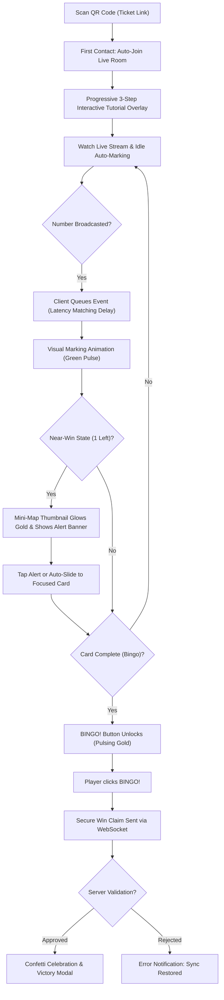
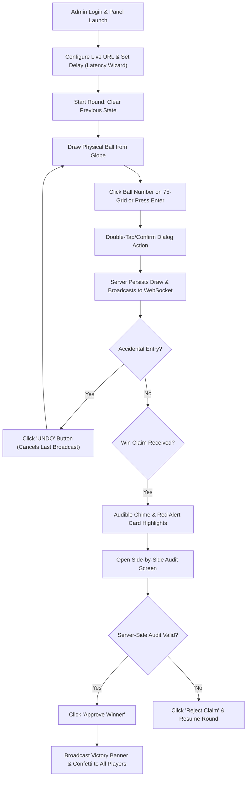

# Chat Conversation

Note: _This is purely the output of the chat conversation and does not contain any raw data, codebase snippets, etc. used to generate the output._

### User Input

Leia o arquivo "Developing The Bingo-AI Platform (3).md" e Vamos continuar de onde paramos

*Listed directory [bingo-ai](file:///e:/bingo-ai) *

*Listed directory [docs](file:///e:/bingo-ai/docs) *

*Viewed [Developing The Bingo-AI Platform (3).md](file:///e:/bingo-ai/docs/Developing%20The%20Bingo-AI%20Platform%20%283%29.md) *

*Listed directory [_bmad-output](file:///e:/bingo-ai/_bmad-output) *

*Listed directory [planning-artifacts](file:///e:/bingo-ai/_bmad-output/planning-artifacts) *

*Viewed [ux-design-specification.md](file:///e:/bingo-ai/_bmad-output/planning-artifacts/ux-design-specification.md) *

*Viewed [SKILL.md](file:///e:/bingo-ai/.agent/skills/bmad-create-ux-design/SKILL.md) *

*Listed directory [steps](file:///e:/bingo-ai/.agent/skills/bmad-create-ux-design/steps) *

*Viewed [step-10-user-journeys.md](file:///e:/bingo-ai/.agent/skills/bmad-create-ux-design/steps/step-10-user-journeys.md) *

*Viewed [prd.md](file:///e:/bingo-ai/_bmad-output/planning-artifacts/prd.md) *

*Viewed [config.yaml](file:///e:/bingo-ai/_bmad/bmm/config.yaml) *

### Planner Response

Olá, Jeyson! Li com atenção o arquivo [Developing The Bingo-AI Platform (3).md](file:///e:/bingo-ai/docs/Developing%20The%20Bingo-AI%20Platform%20%283%29.md) e o nosso documento atual de especificação de design [ux-design-specification.md](file:///e:/bingo-ai/_bmad-output/planning-artifacts/ux-design-specification.md).

Estamos na **Etapa 10: Fluxos de Jornada do Usuário (User Journey Flows)**. 

### Análise de UX e Direcionamento Técnico
A partir do alinhamento do *Party Mode* anterior e das suas excelentes contribuições sobre usabilidade, consolidamos as seguintes premissas para a experiência:
1. **Layout Desktop "Cinema-Streaming"**: O vídeo fica em destaque no topo, com o chat comunitário à direita (incentivando a socialização regional) e o "Cartelão" (com as 4 cartelas ativas) disposto logo abaixo.
2. **Layout Mobile "Carrossel com Mini-Mapa"**: Em telas pequenas, focamos em uma cartela principal em tela cheia com um "Mini-Mapa" horizontal no topo. Quando uma pedra é marcada em outra cartela, o Mini-Mapa pulsa em verde com um indicador (`+1`). Se a cartela atingir o estado de "Quase lá!" (1 número restante), o Mini-Mapa brilha em dourado e, após 2 segundos (ou um clique do usuário), a tela faz uma transição suave para focar na cartela vencedora, evitando desorientação (conforme sugerido pela especialista Sally).
3. **Sincronização com Latência de Live**: O fluxo técnico precisa garantir que os eventos de WebSocket sejam enfileirados e acionados no frontend respeitando o delay configurado pelo administrador.

Seguindo a regra de que a **especificação deve ser escrita em inglês** (conforme a configuração `document_output_language` definida no projeto), preparei o conteúdo abaixo para ser adicionado ao documento de especificações de design UX.

---

### Proposta de Conteúdo para o Arquivo de Especificação (`ux-design-specification.md`):

```markdown
## User Journey Flows

### Player Journey: Maria's "Stress-Free" Experience

Maria represents the primary end-user who needs maximum accessibility and zero stress. Her journey covers the entire gameplay lifecycle: onboarding, real-time tracking, near-win excitement, and a successful victory claim.

#### Journey Narrative & Flow
1. **Entry Point**: Maria scans the QR code on her printed physical ticket. No account creation or password setup is required (minimizing friction).
2. **Onboarding (Progressive Disclosure)**: A non-blocking 3-step interactive highlight tutorial guides her through the UI elements (Live Stream, Auto-Marking Cartelão, and the Bingo Claim Button).
3. **Active Gameplay (Sincronia Core)**: She watches the embedded YouTube Live broadcast. When a number is drawn by the Admin, the server sends a WebSocket event. The client-side latency manager queues this event based on the calculated live delay (e.g., 10 seconds), executing the visual "marking" animation (a subtle, pleasing green pulse) exactly when the number is announced on screen.
4. **Mini-Map Navigation**: In mobile view, since all 4 cards cannot fit comfortably, a compact "Card Mini-Map" is displayed at the top. The active card is shown in full. If an inactive card receives a marking, the Mini-Map thumbnail flashes green and shows a "+1" badge.
5. **Near-Win ("Quase Lá!") state**: When any card requires only 1 more number to win, its Mini-Map thumbnail glows gold, a haptic vibration triggers (if supported), and a banner flashes: "Card 3 is almost there! Only 1 number left!". Clicking the banner or waiting 2 seconds automatically slides the main view to focus on Card 3.
6. **Victory Claim**: When the final number is marked on any card, the giant "BINGO!" button at the bottom of the screen unlocks, changing from gray to pulsing gold. Clicking it sends a secure WebSocket message to the server for instant verification, showing an elegant "Verifying your claim..." spinner.
7. **Success Celebration**: Once verified by the server, a client-side confetti explosion triggers, and a victory overlay is shown, while the Admin announces her winning ticket.



### Admin Journey: Sr. José's "Confident Control" Experience

Sr. José is the local event coordinator. He needs an interface that feels robust, official, and easy to operate without fear of mistakes.

#### Journey Narrative & Flow
1. **Entry Point**: José logins to the secure Admin Panel.
2. **Stream & Delay Configuration**: Enters the YouTube Live Stream URL. The system prompts a "Latency Sync Wizard" where he can quickly adjust the broadcast delay (0-30s) so that the automated marking matches the delayed video feed.
3. **Drawing Gameplay Loop**: Drawing a physical ball from the cage, José clicks the matching number on the 75-key grid. To prevent accidental clicks, the number requires a quick double-tap or a keyboard press (Enter) to confirm. An "Undo" (Desfazer) button remains prominent in red to immediately cancel the last call.
4. **Triage of Win Claims**: When a player clicks "BINGO!", José's screen displays a modal overlay with an audible chime, flashing "CLAIM RECEIVED: Ticket #1234 (Maria)".
5. **Auditing Verification**: The verification engine performs a server-side audit. The panel displays a side-by-side verification view: the exact numbers drawn so far versus the state of Maria's card, highlighting matching items. The system displays a status: "100% SECURE & VALIDATED".
6. **Resolution**: José clicks "Approve Winner", which broadcasts a flashing victory banner and confetti to all active players.



### Journey Patterns

Across these flows, several core UX patterns have been established to provide consistency and ease of use:
1. **The "Delayed Mirror" Pattern (Sincronia)**: Client-side event queues hold state updates until the delay counter matches the video stream, syncing digital action with live emotion.
2. **Visual Hierarchy and Progressive Overlays (Onboarding)**: Large touch targets, avoiding hidden menus, and highlighting controls sequentially instead of loading heavy text manuals.
3. **Synchronized Verification Loop**: Complete transparency between player claim, server-side proof-of-state validation, and admin approval, which completely eliminates physical check errors.
4. **The "Mini-Map Tracker" (Mobile Viewport)**: A structural layout pattern that gives a visual birds-eye overview of multiple cards (Cartelão) in a confined screen space, keeping the user in control without manual navigation.

### Flow Optimization Principles

To guarantee maximum engagement and minimum friction:
1. **Zero-Setup Player Entrance**: Direct ticket activation through a QR code scan bypasses traditional registration hurdles (e.g., email, password setup), maximizing the speed of the "Aha!" moment.
2. **Reduced Cognitive Load for Admins**: Key-bind shortcuts, color-coded grid states, and distinct double-tap mechanisms ensure error-free operation even in high-stress live environments.
3. **Server-Side Security & Client-Side Delight**: Win validation is executed purely on the backend to avoid client-side tampering, while the client focuses entirely on celebrating the moment with haptics, sounds, and particle simulations.
```

---

### O que você gostaria de fazer?

Escolha uma das opções abaixo para prosseguirmos:

*   **[A] Advanced Elicitation** - Aprofundar e debater regras mais detalhadas desses fluxos (por exemplo, como lidar com uma queda temporária de internet na jornada da Maria).
*   **[P] Party Mode** - Chamar o nosso time de especialistas (Sally, Winston, Amelia, etc.) para fazer uma análise crítica e técnica dos fluxos desenhados.
*   **[C] Continuar** - Gravar este conteúdo de jornadas de usuário no arquivo `ux-design-specification.md` e avançar para o planejamento da **Estratégia de Componentes** (Component Strategy).

### User Input

Vamos continuar com o planejamento da Estratégia de Componentes

*Viewed [Requesting BMad Workflow Guidance.md](file:///e:/bingo-ai/docs/Requesting%20BMad%20Workflow%20Guidance.md) *

*Edited relevant file*

*Viewed [step-11-component-strategy.md](file:///e:/bingo-ai/.agent/skills/bmad-create-ux-design/steps/step-11-component-strategy.md) *

### Planner Response

Ótimo! O arquivo de especificação já foi atualizado com sucesso com todos os detalhes e diagramas de fluxo de jornada da Maria e do Sr. José.

Agora, avançamos para a **Etapa 11: Estratégia de Componentes (Component Strategy)**.

---

### Análise de Cobertura do Design System (Vuetify / Material Design)
Para implementar o **bingo-ai** usando **Vue.js + Vuetify**, faremos uma análise de lacunas (Gap Analysis) entre o que o Vuetify fornece nativamente e os componentes altamente personalizados que o nosso jogo exige.

#### 1. Componentes Nativos do Vuetify (Aproveitamento Direto):
*   `v-app`, `v-main`, `v-footer`: Estrutura geral da página e layouts responsivos.
*   `v-btn`: Botão gigante de "BINGO!" e botões administrativos.
*   `v-dialog`: Telas modais para a vitória e o tutorial de onboarding.
*   `v-text-field`, `v-btn-toggle`: Entradas de código de cartela e controles de atraso do Admin.
*   `v-progress-linear`: Barras de progresso das cartelas.

#### 2. Lacunas Identificadas (Componentes Customizados Necessários):
Precisamos desenhar componentes customizados exclusivos que herdam os tokens visuais (cores e fontes) do nosso tema "Comunidade Vibrante", mas que possuem comportamentos específicos de jogo:

*   `BingoCard`: A cartela de bingo em si (grid de 5x5), com animações de pulso para marcação e brilhos para o estado "Quase lá!".
*   `CardMiniMap`: O mini-mapa horizontal para mobile que rastreia o progresso das 4 cartelas ao mesmo tempo e gerencia alertas rápidos de "Quase lá!".
*   `YouTubeSyncPlayer`: O player de vídeo integrado que se comunica com o motor de latência do WebSocket.
*   `AdminDrawBoard`: O painel com a grade de 75 números para o Sr. José registrar as pedras de forma segura (com proteção contra cliques acidentais).

---

### Proposta de Conteúdo para o Arquivo de Especificação (`ux-design-specification.md`):

```markdown
## Component Strategy

### Design System Components

The project is built on **Vuetify** (Material Design library for Vue 3). We will leverage its standard components for foundation elements:
*   **Application Layout**: `v-app`, `v-main`, and `v-container` to maintain cohesive margins and a robust responsive grid system.
*   **Forms & Inputs**: `v-text-field` for ticket activation codes and `v-slider` / `v-btn-toggle` for admin sync settings.
*   **Feedback & Modals**: `v-dialog` for the interactive step-by-step onboarding walkthrough and the final victory celebration screen.
*   **Navigation & Tabs**: `v-tabs` as a fallback tab selector for responsive views.

### Custom Components

Due to the unique gaming nature of **bingo-ai**, we require several custom-designed components optimized for performance, accessibility, and real-time WebSocket communication.

#### 1. `BingoCard`

*   **Purpose**: Displays a single 5x5 grid of bingo numbers with highly visible automated marking indicators.
*   **Usage**: Rendered inside the player's game room (1 card focused on Mobile, 4 cards in a grid on Desktop).
*   **Anatomy**:
    *   **Header**: Standard "B I N G O" letters in high contrast.
    *   **Grid**: 25 cells (5x5). The center cell (3rd row, 3rd column) is pre-marked as a "FREE" spot.
    *   **Near-Win Frame**: A glowing, pulsing gold border.
*   **States**:
    *   `default/unmarked`: White background, dark grey text (`#212121`), standard border.
    *   `marked`: Vivid green background (`#2E7D32`), white text, custom pulse scale transition (0.8x -> 1.1x -> 1.0x).
    *   `near-win`: Triggered when only 1 number remains to achieve a winning pattern. Displays a glowing gold border (`#FFD600`) and a slow pulsation (opacity oscillates between 0.6 and 1.0).
*   **Accessibility**:
    *   `aria-label` dynamically set for each cell: `"Number [X], unmarked"` or `"Number [X], marked green"`.
    *   Color changes are supported by an internal visual check icon, ensuring accessibility for colorblind users (WCAG compliance).

#### 2. `CardMiniMap`

*   **Purpose**: A compact horizontal tracker for mobile screens, giving users a high-level view of all 4 active cards and preventing disorientation.
*   **Usage**: Displayed statically directly below the YouTube player stream and above the focused main `BingoCard`.
*   **Anatomy**:
    *   **Card Thumbnails**: 4 small interactive cards. Each thumbnail represents one physical ticket.
    *   **Progress Indicators**: Small linear progress bars underneath each thumbnail representing the ratio of marked to total numbers (e.g., `12 / 15`).
*   **Interaction Behavior**:
    *   Tapping a thumbnail triggers a smooth horizontal transition in the carousel to focus on that specific card.
*   **States**:
    *   `default`: Solid background with subtle grey border.
    *   `marked-flash`: Flashes emerald green (`#2E7D32`) with a temporary floating `+1` bubble for 1.5 seconds when an off-screen card receives a new matching number.
    *   `near-win-glow`: Slow gold pulse with an exclamation badge (`!`) indicating the card is 1 number away from victory.

#### 3. `YouTubeSyncPlayer`

*   **Purpose**: Renders the stream broadcast and maintains seamless performance on mobile.
*   **Usage**: Anchored at the top of the viewport on mobile (fixed height) and inside the left-hand column on desktop.
*   **Anatomy**: Responsive Iframe wrapper managing the YouTube player instance.
*   **Interaction Behavior**:
    *   Maintains a low-overhead connection.
    *   Displays a minimal top overlay displaying connection status: `"🔴 Live Stream - Sincronizado"`.

#### 4. `AdminDrawBoard`

*   **Purpose**: An interactive control board for the administrator to record called numbers with zero errors.
*   **Usage**: Used exclusively in the Admin dashboard.
*   **Anatomy**:
    *   **75-Key Grid**: Responsive grid representing standard numbers (1 to 75) divided by letters.
    *   **Double-Click Guard**: Visual click confirmation. A single click turns the key amber; a second tap within 500ms or pressing Enter commits the draw to prevent misclicks.
    *   **Last Ball Callout**: Highly visible large circle showing the absolute latest number called.
    *   **Undo Bar**: A prominent red alert header displaying: `"DESFAZER ÚLTIMA PEDRA ([X])"`.
*   **States**:
    *   `idle`: Blue-grey background, clickable.
    *   `pending-confirm`: Flashing amber background, waiting for safety validation.
    *   `drawn`: Deep Navy background (`#1A237E`), disabled.

### Component Implementation Strategy

1.  **Component Encapsulation**: Build all custom components in Vue SFC (Single File Components) using Tailwind CSS for refined micro-interactions and Vuetify's layout variables.
2.  **Shared State & WebSocket Integration**: Use Pinia for centralized game state. The WebSocket service will dispatch events directly to the store, and components like `BingoCard` and `CardMiniMap` will reactively redraw.
3.  **Animation Performance**: Ensure all pulsing and flash transitions use hardware-accelerated CSS properties (`transform`, `opacity`) to maintain smooth 60fps scrolling on low-end mobile devices.

### Implementation Roadmap

#### Phase 1 - Core Gameplay Components (High Priority)
*   **`BingoCard`**: Foundation of the entire app. Essential for core user testing.
*   **`AdminDrawBoard`**: Necessary to simulate number entries and validate server state changes.

#### Phase 2 - Synchrony & Layout (Medium Priority)
*   **`YouTubeSyncPlayer`**: Embedded YouTube player connection and state synchronization engine.
*   **`CardMiniMap`**: High-priority UI layout for mobile multi-card views.

#### Phase 3 - Delights & Guides (Low Priority)
*   **Onboarding Tour Overlay**: 3-step interactive progressive tutorial.
*   **Victory Celebration Modal**: Confetti and audio chimes trigger.
```

---

### Pergunta para Alinhamento

O que você achou dessa divisão? 
1. A estrutura da grade de 75 números com o **Double-Click Guard** (confirmar clicando duas vezes ou pressionando Enter) ajuda o Sr. José a não cometer erros em lives rápidas?
2. A especificação dos estados visuais (Pulsos e Badges de `+1` no Mini-mapa) atende ao que você imagina para dar o efeito "Uau" sem confundir?

Se preferir fazer ajustes, podemos debater. Caso contrário, escolha uma opção:

*   **[A] Advanced Elicitation** - Aprofundar nos requisitos e acessibilidade dos componentes customizados (ex: tamanho de fontes ou interações de teclado).
*   **[P] Party Mode** - Trazer a opinião da desenvolvedora Amelia e do arquiteto Winston para debater a viabilidade técnica de performance dos componentes.
*   **[C] Continuar** - Gravar esta estratégia de componentes no documento e avançar para o mapeamento dos **Padrões de Interface (UX Patterns)** da Etapa 12.

### User Input

Vamos continuar para os padrões de intercace

*Viewed [ux-design-specification.md](file:///e:/bingo-ai/_bmad-output/planning-artifacts/ux-design-specification.md) *

*Viewed [ux-design-specification.md](file:///e:/bingo-ai/_bmad-output/planning-artifacts/ux-design-specification.md) *

*Edited relevant file*

*Viewed [step-12-ux-patterns.md](file:///e:/bingo-ai/.agent/skills/bmad-create-ux-design/steps/step-12-ux-patterns.md) *

### Planner Response

Ótimo, Jeyson! Avançamos agora para a **Etapa 12: Padrões de Consistência de Interface (UX Consistency Patterns)**.

O objetivo desta etapa é garantir que o **bingo-ai** seja previsível, intuitivo e extremamente fácil de interagir. Definiremos padrões consistentes para botões, feedbacks visuais de sincronia, validação de formulários e navegação responsiva.

---

### Proposta de Conteúdo para o Arquivo de Especificação (`ux-design-specification.md`):

```markdown
## UX Consistency Patterns

### Button Hierarchy

To guide the user's focus during high-emotion gameplay, we enforce a strict visual hierarchy for buttons:

*   **Primary / Call-to-Action (CTA)**
    *   **Usage**: Critical event actions like submitting a win claim ("BINGO!") or confirming a ball draw in the Admin Panel.
    *   **Visual Design**: Solid color fills. For players, pulsing Ouro (`#FFD600`) with high-contrast dark indigo text (`#1A237E`). For Admin, solid Royal Blue (`#1A237E`) with white text. Rounded edges (`border-radius: 8px`), minimal height of `48px` to ensure thick touch targets.
    *   **Behavior**: Smooth hover transition (slight darkening) and active scales (shrinks to 0.98x on click for haptic visual feedback).
*   **Secondary / Navigational**
    *   **Usage**: Minor UI state adjustments, such as opening the tutorial, toggling view modes, or switching focused cards manually.
    *   **Visual Design**: Outlined borders (`1.5px` border width in `#BDBDBD`), transparent background, dark text.
*   **Destructive / Danger Actions**
    *   **Usage**: Undoing the last drawn number ("DESFAZER") or cancelling/ending an active game round.
    *   **Visual Design**: Solid deep red background (`#C62828`) with bold white text. Always positioned away from typical click zones to avoid misclicks.

### Feedback Patterns

Given the real-time, hybrid nature of **bingo-ai**, visual and audio feedback must instantly confirm system states:

*   **Real-Time Synchrony (Fidelity Indicator)**
    *   **Usage**: Displays the status of the connection and stream latency.
    *   **Visual Design**: Small static tag positioned near the live video.
        *   `Connected`: Pulsing green dot with text `"🔴 Live Stream - Sincronizado"`.
        *   `Reconnecting`: Amber pulsing dot with text `"Ajustando sincronia..."`.
        *   `Disconnected`: Solid red dot with text `"Sem conexão. Tentando reconectar..."`.
*   **Near-Win Notification ("Quase Lá!")**
    *   **Usage**: Triggered when a card requires exactly 1 remaining number to claim Bingo.
    *   **Visual Design**: A non-intrusive golden toast banner slides in at the top of the card arena: `"Cartela 3 está quase lá! Falta apenas 1 número!"`. The corresponding `CardMiniMap` thumbnail glows with a pulsing golden border (`#FFD600`).
    *   **Haptics & Audio**: A short, distinct vibration pattern (if supported by browser) accompanied by a subtle "woosh" chime.
*   **Success Verification**
    *   **Usage**: Confirms a successful ticket activation or an approved Bingo win.
    *   **Visual Design**: Emerald green banner (`#2E7D32`), checkmark icon animations, and a full-screen canvas confetti explosion celebrating the win.

### Form Patterns & Ticket Validation

*   **Frictionless Ticket Input**
    *   **When to Use**: During the initial onboarding state when players input their physical card codes.
    *   **Visual Design**: A single, centered high-contrast input field with large capital placeholders (`Ex: ABC-123`). Text input automatically forces uppercase formatting.
    *   **Behavior (Auto-Submit)**: Once the user inputs exactly 6 characters, the system displays an inline loading spinner and auto-submits the form immediately, bypassing the need for a secondary "Enviar" button and speeding up the "Aha!" moment.
    *   **Accessibility**: Input holds `autofocus` on mount, `aria-required="true"`, and displays clear error feedback below the field (`"Código inválido. Verifique sua cartela."`).

### Navigation Patterns

*   **Zero Hidden Controls (No Hamburgers)**
    *   **Guidance**: Traditional slide-out hamburger menus are forbidden in the player room. Elderly and digital-novice users struggle to locate hidden settings. All game controls (Video, Cards, Onboarding Help) are persistent on screen.
*   **Responsive Viewport Split**
    *   **Mobile Port**: Top-down linear stack. Fixed video stream on top -> Horizontal `CardMiniMap` -> Focused `BingoCard` Carousel.
    *   **Desktop Port**: Dual-column streaming layout. Left column hosts the video player and structural chat console, while the bottom section displays the full "Cartelão" (all 4 cards arranged in a clean 2x2 grid), removing the need for mini-maps or horizontal scrolls.
```

---

### Pergunta para Alinhamento

Essa proposta de padrões está alinhada com as suas expectativas para a facilidade de uso do **bingo-ai**?
1. O **Auto-Submit de Cartela** ao digitar os 6 dígitos reduz a fricção inicial do jogador e agiliza a entrada no jogo.
2. A proibição do **Menu Hambúrguer** e o foco em manter todas as ações críticas sempre visíveis na tela é ideal para Maria (idosa/leiga).

Caso queira ajustar algum padrão (como as cores, o comportamento do botão, etc.), por favor me avise! Se estiver tudo de acordo, escolha a sua opção:

*   **[A] Advanced Elicitation** - Aprofundar nos estados de erro e recuperação de formulários (ex: o que mostrar se a cartela digitada já foi ativada por outra pessoa).
*   **[P] Party Mode** - Trazer o debate de UX com a especialista Sally e o PM John para avaliar o engajamento desses padrões visuais.
*   **[C] Continuar** - Gravar estes padrões de consistência no arquivo `ux-design-specification.md` e avançar para a especificação de **Design Responsivo e Acessibilidade (Responsive & Accessibility)** da Etapa 13.

### User Input

Vamos continuar com o Design Reponsivo e Acessibilidade.

*Viewed [ux-design-specification.md](file:///e:/bingo-ai/_bmad-output/planning-artifacts/ux-design-specification.md) *

*Viewed [ux-design-specification.md](file:///e:/bingo-ai/_bmad-output/planning-artifacts/ux-design-specification.md) *

*Edited relevant file*

*Viewed [step-13-responsive-accessibility.md](file:///e:/bingo-ai/.agent/skills/bmad-create-ux-design/steps/step-13-responsive-accessibility.md) *

### Planner Response

Ótimo! O arquivo de especificação foi modificado para incluir os padrões de interface consistente. 

Chegamos à **Etapa 13: Design Responsivo e Acessibilidade (Responsive Design & Accessibility)**.

Para o **bingo-ai**, o design responsivo e a acessibilidade não são apenas requisitos técnicos de conformidade, mas sim **fatores críticos de sucesso do negócio**. Como o nosso público-alvo inclui idosos (ex: Maria) e pessoas leigas digitais que jogam pelo celular ou computador, a interface deve ser extremamente adaptável e altamente inclusiva.

Abaixo está o detalhamento técnico de adaptabilidade e acessibilidade que preparei para o nosso documento de especificação:

---

### Proposta de Conteúdo para o Arquivo de Especificação (`ux-design-specification.md`):

```markdown
## Responsive Design & Accessibility

### Responsive Strategy

The **bingo-ai** platform utilizes a tailwind-powered responsive grid and Vuetify framework logic to adapt the layout seamlessly across diverse screen profiles:

*   **Desktop Strategy (Width >= 1024px)**
    *   **Layout Structure**: A robust two-column dashboard. The left column (65% width) contains the `YouTubeSyncPlayer` and a lightweight live chat panel beneath it. The right column (35% width) displays the active ticket manager where the full "Cartelão" (4 cards) is rendered in a neat 2x2 grid.
    *   **Focus**: Maximum information density for players tracking multiple cards on laptops or desktop PCs.
*   **Tablet Strategy (Width 768px - 1023px)**
    *   **Layout Structure**: Adaptive orientation. In **landscape**, the desktop layout is compressed with chat hidden or minimized. In **portrait**, a top-down stacked layout is utilized: Stream player on top, cards displayed below in a 2x2 layout.
*   **Mobile Strategy (Width 320px - 767px)**
    *   **Layout Structure**: A strictly focused mobile-first stack. The `YouTubeSyncPlayer` is statically pinned to the top of the screen (occupying 25-30% of viewport height). The horizontal `CardMiniMap` is placed directly below the player. A carousel renders exactly one `BingoCard` at a time, preventing cognitive overload and visual clutter.

### Breakpoint Strategy

We enforce standard Vuetify screen width breakpoints to trigger clean layout transformations:
*   **Mobile (Extra Small & Small)**: `320px` to `767px`
*   **Tablet (Medium)**: `768px` to `1023px`
*   **Desktop (Large & Extra Large)**: `1024px+`

**Design Philosophy**: A **Mobile-First** approach is prioritized for the Player Game Room (maximizing compatibility for standard smartphones), while a **Desktop-First** approach is utilized for the Admin Control Panel, which requires rich data density.

### Accessibility Strategy

To ensure elderly players (like Maria) can participate independently and without fear of mistakes, we enforce **WCAG 2.1 Level AA** guidelines:

*   **Color & Visual Contrast**
    *   **Requirement**: Minimum contrast ratio of **4.5:1** for all body copy and **3.0:1** for large heading components.
    *   **Colorblind Support**: Cells marked green (`#2E7D32`) do not rely solely on color; they display a visual check icon (`✓`) to differentiate marked states from unmarked white cells.
*   **Touch Targets & Spacing**
    *   **Requirement**: All clickable elements (numbers, buttons, navigation thumbnails) must maintain a minimum touch target size of **48px x 48px** (exceeding standard 44px limits) with at least **8px** of separation.
*   **Keyboard Navigation (A11y & Admin efficiency)**
    *   **For Admin**: Sr. José can operate the draw board completely hands-free using hotkeys (Type number + `Enter` to confirm, `Esc` to dismiss confirmation, `Ctrl+Z` to undo last ball).
    *   **For Players**: Full keyboard tab-stops. Focus indicators are styled with a bold golden border (`3px solid #FFD600`) to remain highly visible.
*   **Screen Reader Compatibility (Semantic Markup & ARIA)**
    *   **Requirement**: Use native HTML5 landmarks (`<main>`, `<header>`, `<nav>`).
    *   **Dynamic Announcements**: An active `aria-live="polite"` region is integrated to verbally announce newly called numbers: `"Pedra 42 sorteada!"` or near-win triggers: `"Cartela 3 está quase lá!"`.

### Testing Strategy

*   **Responsive Testing**
    *   **Simulated Testing**: CPU and network throttling inside Chrome DevTools to mimic low-end smartphones on restricted 3G community networks.
    *   **Real-Device Auditing**: Validate layout rendering on iOS Safari and Android Chrome across varying viewports.
*   **Accessibility Testing**
    *   **Automated Validation**: Run Axe Core or Google Lighthouse scans to secure a 100% accessibility compliance score.
    *   **Manual Evaluation**: Keyboard-only test walks (navigating, activating cards, claiming Bingo using only tab and space keys).
    *   **Assistive Technology Test**: Execute flows using native screen readers (VoiceOver on iOS, TalkBack on Android).

### Implementation Guidelines

*   **Responsive Layouts**
    *   Avoid hardcoded pixel dimensions (`px`). Utilize relative units (`rem`, `%`, `vh`, `vw`) for sizing, typography, and margins.
    *   Toggle layout elements using Vuetify display helpers (e.g., `d-md-block d-none` to isolate desktop chat).
*   **Semantic Accessibility**
    *   Enforce `aria-label` values for all card cells indicating the number and current marking state dynamically.
    *   Manage focus states deliberately. When the player wins, programmatically shift focus to the newly unlocked "BINGO!" button so screen readers read the CTA immediately.
```

---

### Pergunta para Alinhamento

O que você achou desta estratégia responsiva e de acessibilidade?
1. O **Tamanho Mínimo de Toque de 48px x 48px** e o **Contraste de 4.5:1** garantem que a Maria consiga ver e marcar os números com muita facilidade no celular.
2. A acessibilidade por teclado para o Admin (Sr. José) permite que ele digite as pedras rapidamente usando o teclado numérico do computador sem precisar do mouse, evitando atrasos.

Caso queira fazer algum ajuste, me avise! Se concordar, escolha uma das opções abaixo:

*   **[A] Advanced Elicitation** - Aprofundar e detalhar comportamentos de leitores de tela em situações críticas (ex: como o leitor deve anunciar que a cartela foi verificada e aprovada).
*   **[P] Party Mode** - Trazer o debate com os especialistas do time (Amelia, Winston e Sally) para discutir se a latência das lives e o uso do leitor de tela funcionam em harmonia sem sobrepor áudio.
*   **[C] Continuar** - Gravar estas definições responsivas e de acessibilidade no arquivo `ux-design-specification.md` e avançar para o encerramento do fluxo (Finalização).

### User Input

Continuar

*Viewed [ux-design-specification.md](file:///e:/bingo-ai/_bmad-output/planning-artifacts/ux-design-specification.md) *

*Viewed [ux-design-specification.md](file:///e:/bingo-ai/_bmad-output/planning-artifacts/ux-design-specification.md) *

*Edited relevant file*

*Viewed [step-14-complete.md](file:///e:/bingo-ai/.agent/skills/bmad-create-ux-design/steps/step-14-complete.md) *

*Listed directory [_bmad](file:///e:/bingo-ai/_bmad) *

*Listed directory [_config](file:///e:/bingo-ai/_bmad/_config) *

*Viewed [manifest.yaml](file:///e:/bingo-ai/_bmad/_config/manifest.yaml) *

*Viewed [customize.toml](file:///e:/bingo-ai/.agent/skills/bmad-create-ux-design/customize.toml) *

*Viewed [ux-design-specification.md](file:///e:/bingo-ai/_bmad-output/planning-artifacts/ux-design-specification.md) *

*Edited relevant file*

### Planner Response

🎉 **Parabéns, Jeyson! Concluímos com sucesso a Especificação de Design UX do bingo-ai!** 🥳

Trabalhamos de forma colaborativa para transformar a visão e as necessidades do seu público-alvo (jogadores como Maria, organizadores como o Sr. José e vendedores como o Roberto) em uma estrutura de design sólida, moderna, extremamente clara e 100% inclusiva.

O documento oficial de especificações está completamente finalizado (todas as 14 etapas concluídas!) e salvo em:
🔗 **[Especificação de Design UX (Markdown)](file:///e:/bingo-ai/_bmad-output/planning-artifacts/ux-design-specification.md)**

---

### 📋 O que Realizamos Juntos:
1. **Entendimento do Contexto e Público-Alvo**: Alinhamento de personas reais (Maria e Sr. José) e análise das frustrações e desejos com tecnologia.
2. **Definição da Experiência Central**: A "Marcação Mágica em Sincronia" como o coração emocional da aplicação, transformando a tensão do marcador tradicional em entretenimento e diversão.
3. **Padrões de Inspiração**: Análise de referências de sucesso (YouTube, WhatsApp, Candy Crush) para projetar uma interface familiar.
4. **Fundação Visual & Design System**: Escolha do **Material Design (via Vuetify)** com o tema personalizado **"Comunidade Vibrante"** (Azul Real e Ouro para euforia e confiança).
5. **Mockups de Direção Visual**: Criação do showcase de mockups em HTML para validar o visual mobile e desktop.
6. **Fluxos de Jornada do Usuário (Mermaid)**: Mapeamento passo a passo da jornada sem fricção do jogador e o painel de controle auditável do administrador.
7. **Estratégia de Componentes Customizados**: Especificações completas do grid dinâmico `BingoCard`, o `CardMiniMap` para múltiplas cartelas em telas pequenas, o `YouTubeSyncPlayer` com enfileiramento de latência e o `AdminDrawBoard` com proteção contra cliques acidentais (**Double-Click Guard**).
8. **Padrões de Interface Consistentes**: Botões de ação, alertas de proximidade de vitória ("Quase Lá!") e formulário de ativação de cartela com **Auto-Submit**.
9. **Estratégia Responsiva e de Acessibilidade**: Layouts adaptativos mobile-first, conformidade com as diretrizes **WCAG 2.1 AA** (contraste, tamanhos mínimos de toque de 48px e leitores de tela) e atalhos de teclado ágeis para o Admin.

---

### 🚀 Próximos Passos Sugeridos:
Agora que a base do design UX está totalmente pavimentada, você pode guiar o desenvolvimento através de diferentes fluxos:

1. **Criação de Épicos e Histórias** (Recomendado): Usar a *skill* `/create the epics and stories list` ou solicitar a criação de tarefas práticas para quebrar essa especificação de UX em cartões de desenvolvimento claros.
2. **Arquitetura da Solução**: Detalhar a conexão Spring Boot + Vue 3 baseada nos novos estados de WebSocket identificados nos fluxos de UX.
3. **Desenvolvimento de Componentes no Vue.js / Vuetify**: Iniciar a codificação dos componentes customizados (`BingoCard`, `CardMiniMap`, `AdminDrawBoard`) conforme especificado na fase de Componentes.

Se precisar de ajuda para saber o que fazer em seguida no framework BMad, recomendo usar a *skill* de ajuda do BMad digitando algo como: *"Quais ferramentas ou etapas BMad posso iniciar agora?"*.

**Foi uma excelente jornada de design UX! Estou pronto para avançar para a próxima fase com você. O que gostaria de fazer agora?**