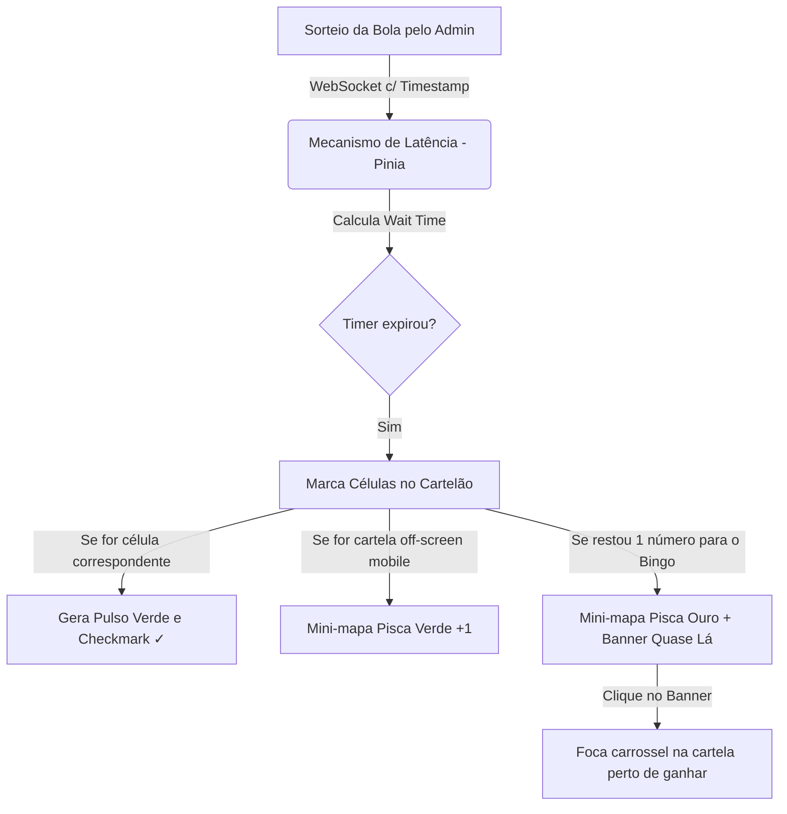

# Documentação de Implementação - Epic 4 (Histórias 4.1, 4.2 & 4.3)

Este documento descreve detalhadamente as mudanças realizadas para a conclusão de toda a **Epic 4: Synchronized Passive Gameplay & Automated Marking Engine**, englobando:
1. **Mecanismo de Alinhamento de Latência do Cliente (Story 4.1)**
2. **Marcação Automática com Acessibilidade das Cartelas (Story 4.2)**
3. **Seletor de Mini-Mapa Mobile & Alertas "Quase Lá!" (Story 4.3)**

---

## 1. Visão Geral do Fluxo e Funcionamento da Epic 4

A Epic 4 fornece uma experiência de jogo passiva automatizada, contínua e acessível. A sincronização com a live do YouTube e o suporte móvel para múltiplas cartelas simultâneas são orquestrados reativamente no frontend por meio do Pinia Store e dos recursos de animação CSS avançados do Vue 3.

---

## 2. Detalhamento de Implementação por História

### 2.1 Story 4.1: Mecanismo de Alinhamento de Latência do Cliente
*   **Banco de Dados**: Coluna `stream_delay_seconds` adicionada à tabela `events` via script Flyway [V4__add_stream_delay_to_events.sql](file:///d:/Users/bingo-ai/bingo-backend/src/main/resources/db/migration/V4__add_stream_delay_to_events.sql) para persistência global do delay configurado.
*   **Backend REST e WS**: 
    *   Implementado o endpoint `PUT /api/v1/events/{eventId}/delay` no controller [GameController.java](file:///d:/Users/bingo-ai/bingo-backend/src/main/java/com/bingoai/backend/game/GameController.java) e o broadcast de atualização no [GameWebSocketController.java](file:///d:/Users/bingo-ai/bingo-backend/src/main/java/com/bingoai/backend/game/GameWebSocketController.java).
    *   Refatoramos [DrawBallMessage.java](file:///d:/Users/bingo-ai/bingo-backend/src/main/java/com/bingoai/backend/game/dto/DrawBallMessage.java) para transportar o timestamp real de criação do banco de dados, permitindo sincronismo retroativo mesmo em recargas de tela.
*   **Agendamento Pinia**: O store [game.ts](file:///d:/Users/bingo-ai/bingo-frontend/src/stores/game.ts) agora gerencia o agendamento dinâmico através do mapa `_latencyTimeouts`. Os temporizadores são removidos e limpos na retração de bolas (`retractDrawnNumber`) ou na desconexão (`disconnectFromGame`), eliminando o risco de vazamentos de memória e marcações fantasmas.
*   **Debounce do Console**: Inserimos um watcher com debounce de 500ms no slider do console de controle do Admin [EventGameConsole.vue](file:///d:/Users/bingo-ai/bingo-frontend/src/components/admin/EventGameConsole.vue) para evitar sobrecarga de requisições de atualização do delay.

### 2.2 Story 4.2: Marcação Automática "Cartelão" com Acessibilidade
*   **Visual e Semântica**:
    *   Todas as células de [BingoCard.vue](file:///d:/Users/bingo-ai/bingo-frontend/src/components/player/BingoCard.vue) receberam um atributo `:aria-label` que reporta se o número está marcado (ex: `"Number [X], marked green"`, `"Espaço Grátis, marcado"` ou `"Number [X]"`).
    *   A marcação de cor usa o tom verde escuro (`#2E7D32`) com texto e bordas em alto contraste, alcançando conformidade WCAG AA (contraste superior a 4.5:1).
*   **Suporte a Daltônicos**: Células marcadas exibem permanentemente um ícone de checkmark (`✓`) de Vuetify (`mdi-check-bold`), removendo a dependência de cores para indicar o estado de marcação.
*   **Feedback Dinâmico**: Células marcadas disparam uma animação de pulso infinito `@keyframes green-pulse` com dispersão externa de sombra.

### 2.3 Story 4.3: Seletor de Mini-Mapa Mobile & Alertas "Quase Lá!"
*   **Flashes de Cartela Off-screen**:
    *   Implementamos um watcher no conjunto de números marcados (`markedNumbers`) no componente [GameRoom.vue](file:///d:/Users/bingo-ai/bingo-frontend/src/components/player/GameRoom.vue).
    *   Quando um novo número é marcado em uma cartela que não está visível no carrossel do celular (`activeMobileCardIndex !== cardIdx`), o botão do mini-mapa pisca verde (`.dot-flash-green`) e exibe uma etiqueta flutuante com a mensagem `+1` por 1.5 segundos.
*   **Feedback de "Quase Lá!"**:
    *   Sempre que uma cartela atinge exatamente 23 marcações de 24 (1 número restante para completar e concorrer ao prêmio do round), a propriedade computada `nearWinCards` é atualizada.
    *   O botão do mini-mapa correspondente ganha uma borda dourada pulsante (`#FFD600`).
    *   Um banner deslizante (`near-win-banner-alert`) de gradiente dourado desliza no topo da tela do jogador com o texto: `"Card [X] is almost there! Only 1 number left!"`.
    *   Ao tocar no banner, a função `focusNearWinCard(idx)` muda o carrossel para focar e exibir a respectiva cartela imediatamente.

---

## 3. Validação e Compilação
- O backend compila sem erros (`mvn compile`) e todos os testes JUnit rodam e passam com sucesso (`mvn test`).
- O frontend passa 100% livre de erros no validador estático do TypeScript (`npm run type-check`).
